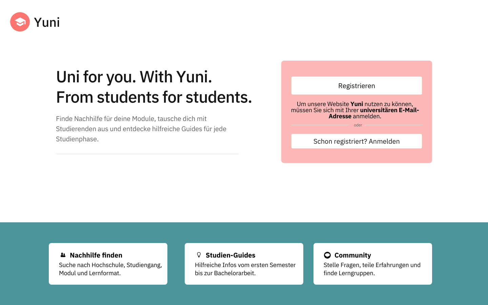
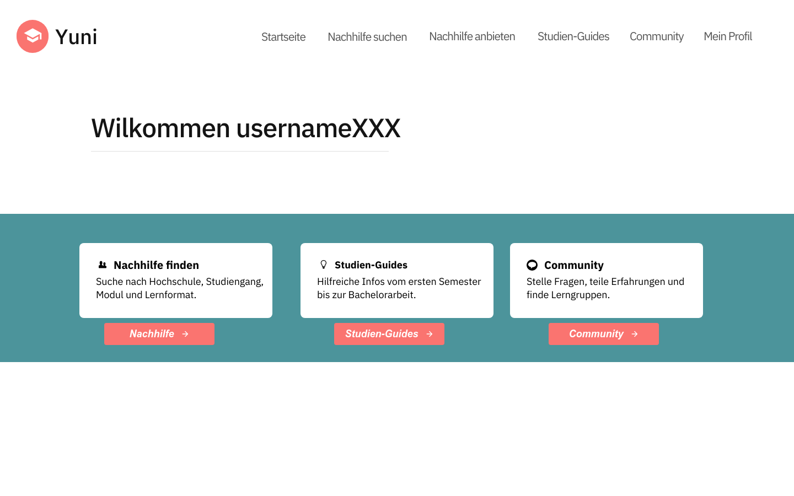
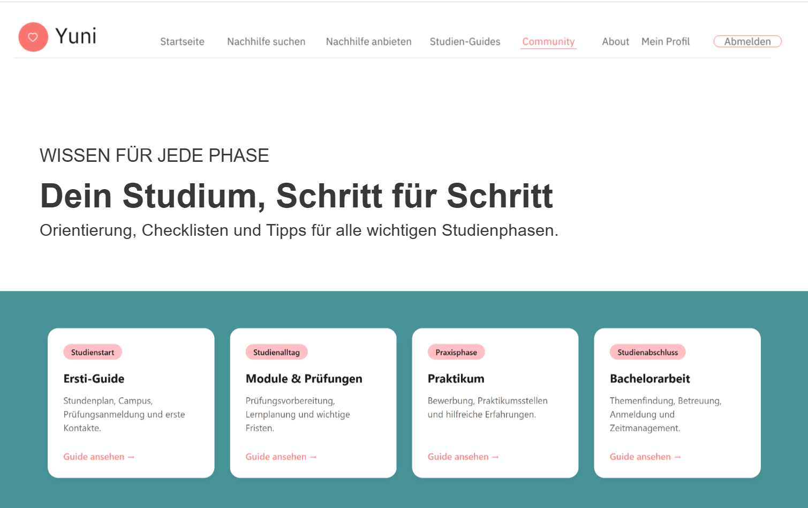
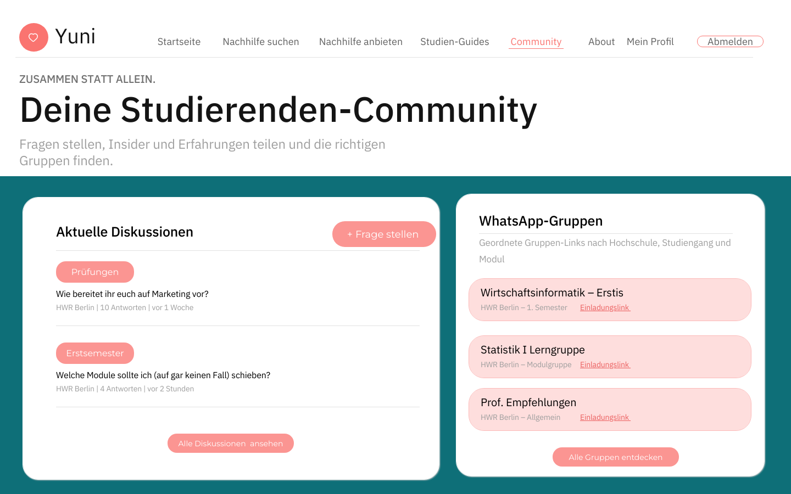
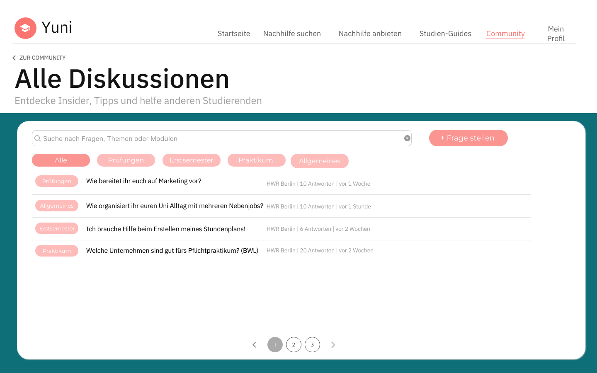
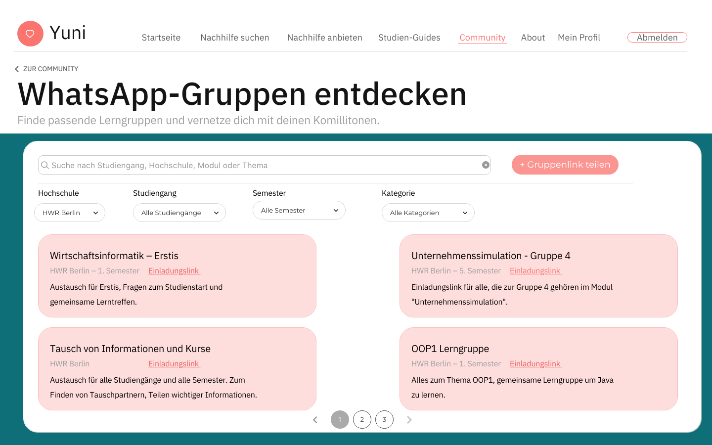
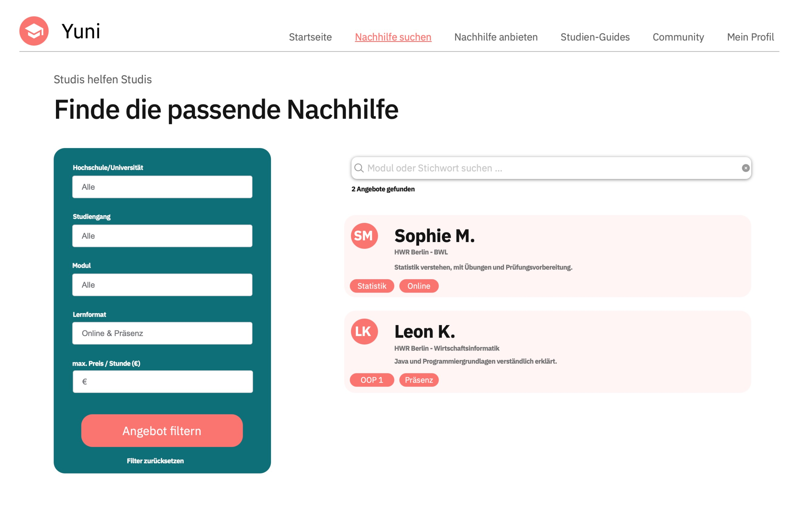
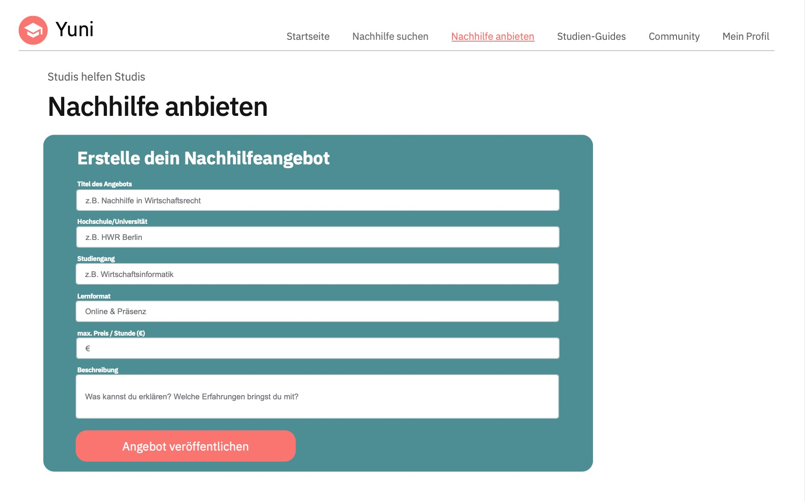

# Yuni (Team 10) - Uni for you!

# Team Composition
#### Teammitglieder und unsere Ziele: 

**Seynabou Mbaye**
- Meine angestrebte Note liegt im Bereich von 1,0 bis 1,3. In diesem Modul möchte ich meine bisherigen Kenntnisse in Python weiterentwickeln und lernen, diese gezielt bei der Entwicklung von Webanwendungen anzuwenden. Zusätzlich möchte ich meine Fähigkeiten im Umgang mit Git und GitHub verbessern, um die Versionsverwaltung und die Zusammenarbeit an gemeinsamen Projekten sicherer zu beherrschen. Diese Erfahrungen sollen mir helfen, sowohl bei zukünftigen Studienprojekten als auch im späteren Berufsleben effektiv in Entwicklungsteams mitzuarbeiten.

**Gizem Söylemez**
- Meine angestrebte Note liegt zwischen **1,0 und 1,3**. Meine persönlichen Lernziele im Rahmen dieses Moduls umfassen insbesondere die Vertiefung meiner bisherigen **Python-Kenntnisse** sowie den Ausbau meines Verständnisses für Backend-Prozesse bei der Entwicklung von Webanwendungen. Darüber hinaus möchte ich mein Verständnis für das **Zusammenspiel zwischen Frontend und Backend** erweitern. Ebenso möchte ich meine Kenntnisse im Umgang mit Git und GitHub vertiefen, um mehr Sicherheit bei der gemeinsamen **Programmierarbeit in Teams** zu gewinnen und mich besser auf die Zusammenarbeit in Entwicklungsteams im späteren Berufsleben vorzubereiten.

**Amine Özdemir**
- Meine angestrebte Note liegt zwischen 1,0 und 1,3. Im Rahmen dieses Moduls möchte ich meine bisherigen Kenntnisse in Python vertiefen und lernen, diese bei der Entwicklung von Webanwendungen praktisch anzuwenden. Darüber hinaus möchte ich ein besseres Verständnis für die Frontend- und Backend-Entwicklung sowie deren Zusammenspiel gewinnen. Ein weiteres Ziel ist es, meine Fähigkeiten im Umgang mit Git und GitHub auszubauen, um die Versionsverwaltung sicherer zu beherrschen und die Zusammenarbeit an gemeinsamen Projekten zu verbessern. Diese Kenntnisse möchte ich sowohl in zukünftigen Studienprojekten als auch im späteren Berufsleben nutzen, um effektiv in Entwicklungsteams mitarbeiten zu können.

**Sophia Lenz** 
- Meine angestrebte Note liegt zwischen **1,0 und 1,3**. Im Rahmen dieses Moduls möchte ich meine Kenntnisse in der Programmiersprache **Python** aufbauen und erweitern. Außerdem möchte ich lernen, **Designentscheidungen fundiert und zielgerichtet** zu treffen. Ein weiteres Ziel ist es, den sicheren Umgang mit **GitHub** zu erlernen, um das Tool später im Berufsalltag selbstständig und selbstbewusst einsetzen zu können. Darüber hinaus möchte ich ein besseres Verständnis für die **Backend-Entwicklung von Websites** gewinnen und nachvollziehen können, wie die technischen Prozesse im Hintergrund funktionieren.

# Value Proposition

## Projektidee: Eine Plattform von Studierenden für Studierende

## Grundidee

Wir entwickeln eine Webplattform, die Studierende miteinander vernetzt, um gegenseitige Unterstützung im Studium zu ermöglichen.

Im Mittelpunkt stehen **Nachhilfe, Wissensaustausch, Orientierung und die Organisation des Studienalltags**.

## 1. Zielgruppe (Customer Segment)

- Studierende aller Semester, insbesondere Erstsemester
- Studierende, die Unterstützung im Studium suchen
- Studierende, die ihr Wissen teilen oder Nachhilfe anbieten möchten
- Fokus auf die eigene Universität (HWR)

## 2. Problemstellung (Pains)

- Fehlende Orientierung im Studienalltag, besonders bei Erstsemestern
- Schwierigkeiten, passende Nachhilfe oder Unterstützung zu finden
- Unübersichtliche Informationen und verstreute WhatsApp-Gruppen
- Offene Fragen zu Modulen, Prüfungen und Studienabläufen
- Fehlende Vernetzung zwischen Studierenden
- Begrenzte Möglichkeiten, neben dem Studium Geld zu verdienen

## 3. Unsere Lösung (Value Proposition)

Eine zentrale Plattform, auf der Studierende Hilfe anbieten, Unterstützung finden und sich miteinander vernetzen können.

Die Plattform verbindet zwei Seiten:

- **Angebot:** Studierende bieten Nachhilfe, Wissen und Erfahrungen an.
- **Nachfrage:** Studierende suchen Unterstützung, Informationen oder Kontakte.

## 4. Geplante Funktionen (Features)

- **Nachhilfevermittlung:** Nachhilfe anbieten und passende Angebote finden
- **Community-Forum:** Fragen stellen, beantworten und Erfahrungen austauschen
- **WhatsApp-Gruppen:** Übersicht relevanter Gruppen und Einladungslinks
- **Ersti-Guide:** Orientierungshilfe für Erstsemester
- **Roadmap:** Wichtige Informationen und Abläufe im Studium
- **Bachelorarbeiten:** Informationen und Hinweise rund um Abschlussarbeiten
- **Praktikum:** Informationen und Unterstützung bei der Praktikumssuche

## 5. Mehrwert für Studierende (Gains)

- Einfachere Vernetzung und gegenseitige Unterstützung
- Schnellere Antworten auf studienbezogene Fragen
- Bessere Orientierung und Organisation
- Gemeinsames Lernen und Wissensaustausch
- Möglichkeit, durch Nachhilfe Geld zu verdienen
- Zentrale Anlaufstelle statt vieler unterschiedlicher Informationsquellen

## 6. Alleinstellungsmerkmal (USP)

Eine Plattform speziell für Studierende der eigenen Universität, die **Nachhilfevermittlung, Community und Studienorganisation** miteinander verbindet.

Im Gegensatz zu allgemeinen Nachhilfeplattformen liegt der Fokus auf dem direkten Austausch zwischen Studierenden derselben Hochschule.

## 7. Mögliche drei Kernfunktionen der Website

### 1. Nachhilfe anbieten und suchen
Die Hauptfunktion der Plattform, die Angebot und Nachfrage miteinander verbindet.

### 2. Guides bezogen auf verschiedene Studienphasen 
Eine zentrale Anlaufstelle für Informationen und Orientierung im Studienalltag.

### 3. Austausch unter Studenten (Community-Forum/geordnete WhatsApp-Links)
Ort für Fragen, Wissensaustausch und gegenseitige Unterstützung.

# Target Scope
##### Design erstellt mit proto.io

