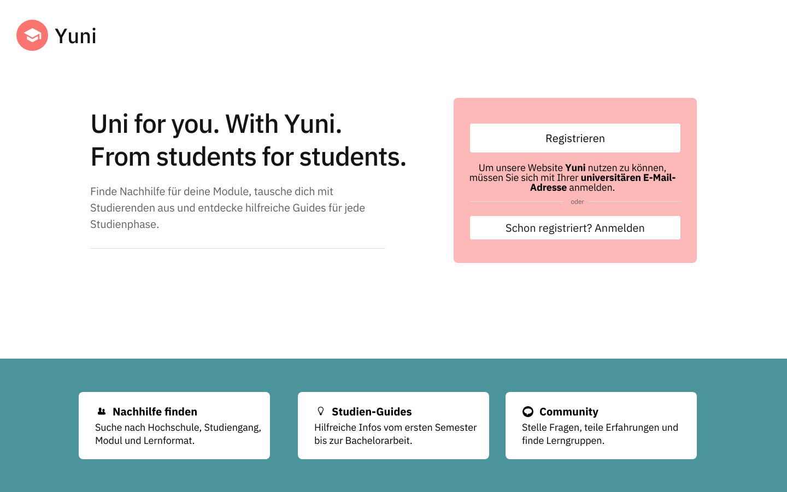
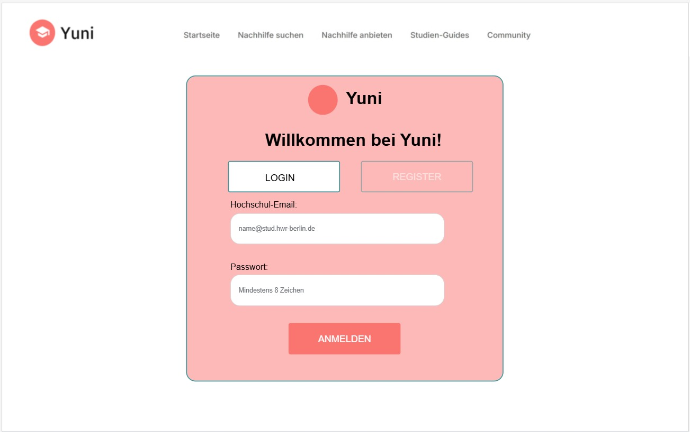
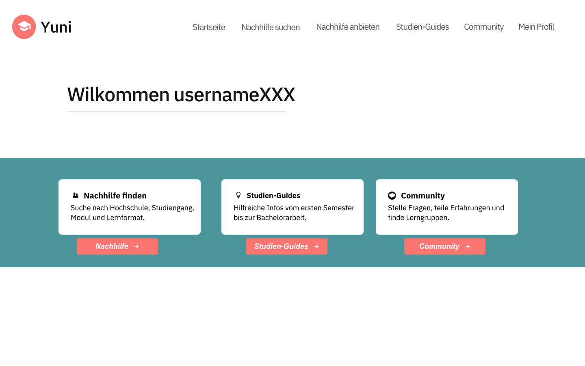
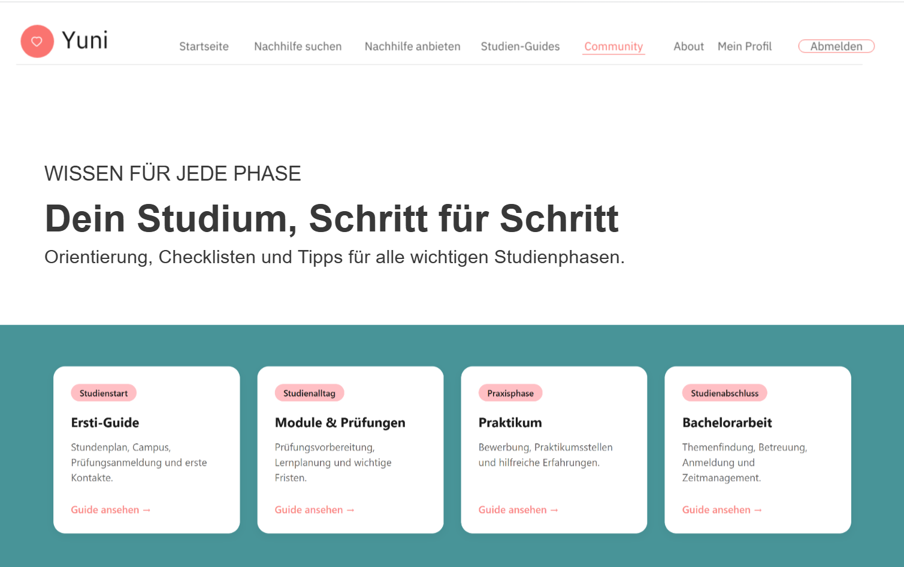
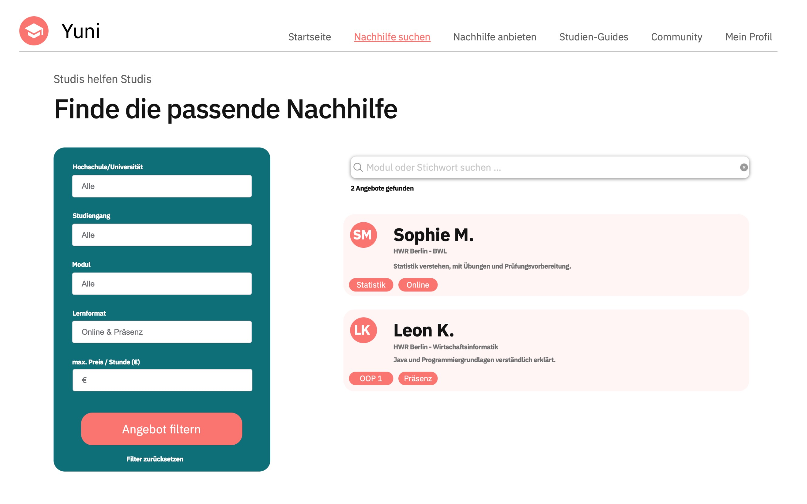
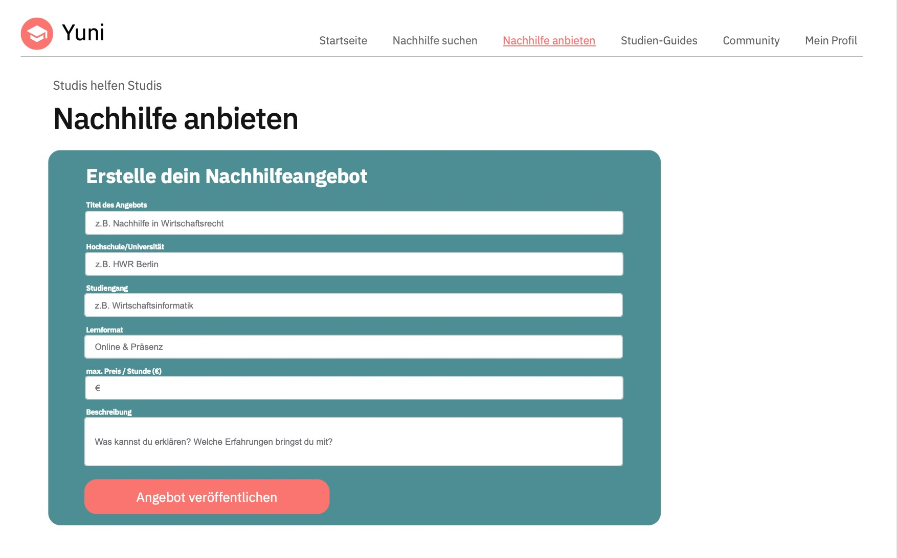
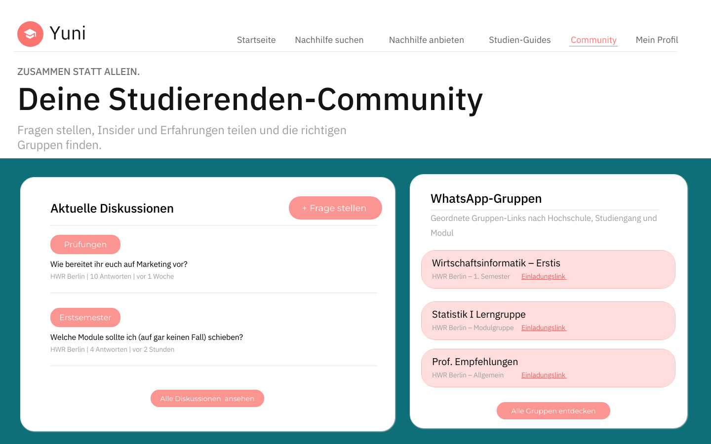
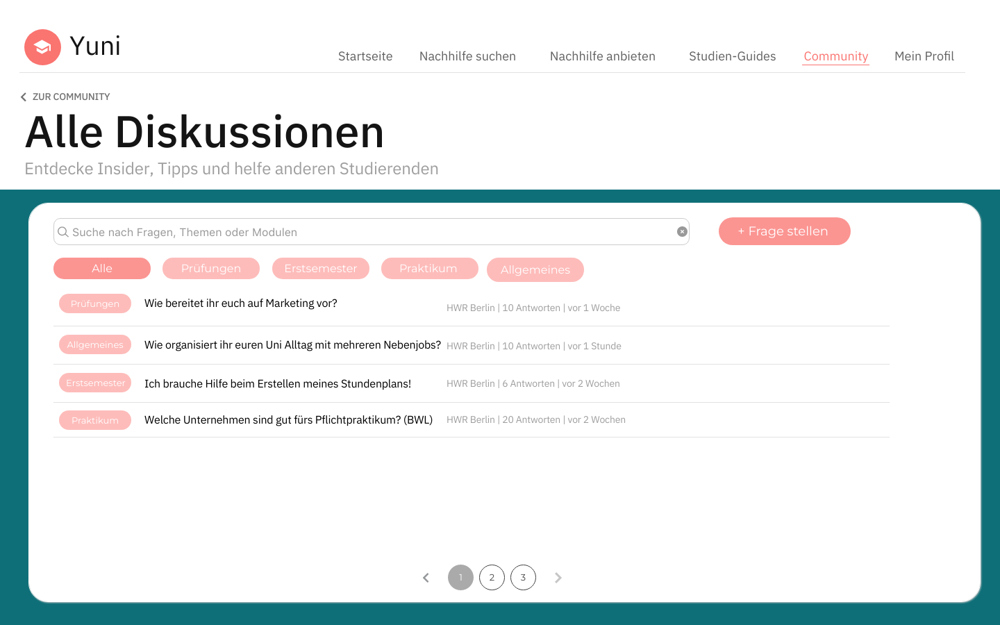
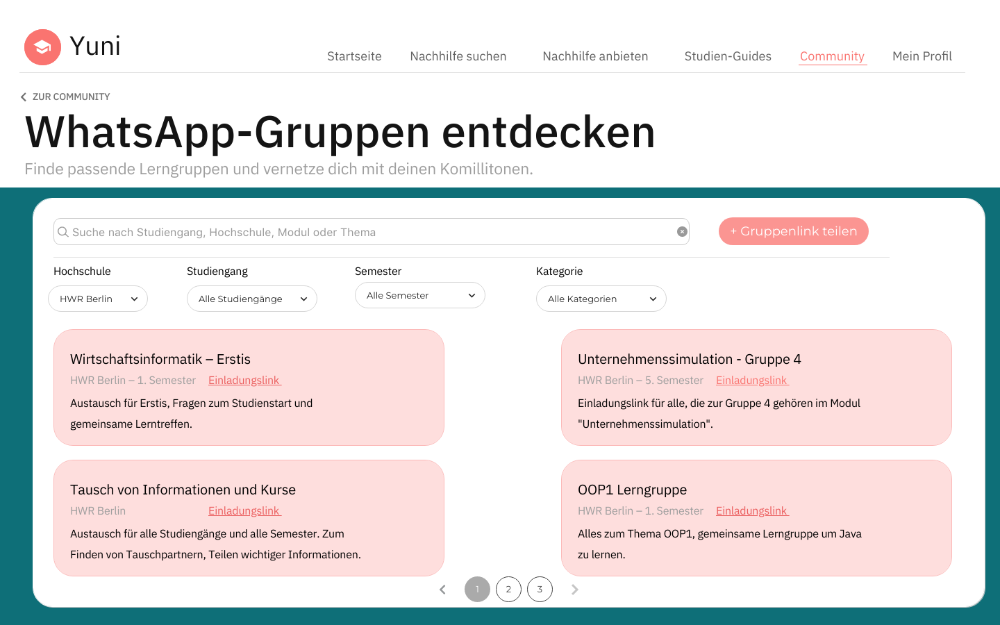
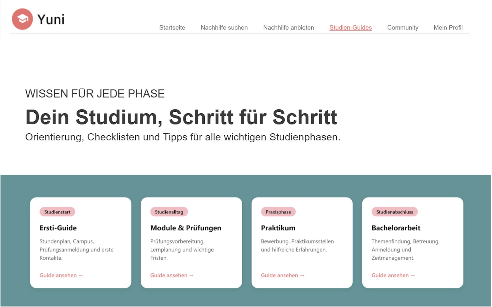

[← Documentation Home](README.md)

# Value Proposition

## Target Users and Their Problems

Unsere Plattform richtet sich an Studierende der Hochschule für Wirtschaft und Recht Berlin (HWR). Sie soll Studierende miteinander vernetzen und die gegenseitige Unterstützung im Studienalltag erleichtern.

Dabei unterscheiden wir zwischen zwei Nutzergruppen: Studierenden, die Unterstützung suchen (Nachfrageseite), und Studierenden, die ihr Wissen und ihre Erfahrungen anbieten möchten (Angebotsseite).

### Demand Side: Studierende, die Unterstüzung suchen

Zur Nachfrageseite gehören Studierende aller Semester, insbesondere Erstsemester, die Unterstützung bei ihrem Studium benötigen.

Gerade zu Beginn des Studiums fällt es vielen schwer, sich im Hochschulalltag zurechtzufinden. Informationen zu Modulen, Prüfungen, Praktika oder organisatorischen Abläufen sind häufig auf verschiedene Webseiten, Plattformen und WhatsApp-Gruppen verteilt.

Auch die Suche nach geeigneter Nachhilfe oder nach erfahrenen Studierenden, die bei fachlichen Fragen helfen können, gestaltet sich oft schwierig.

**Die wichtigsten Probleme dieser Nutzergruppe sind:**
- Fehlende Orientierung im Studienalltag, insbesondere bei Erstsemestern
- Schwierigkeiten, passende Nachhilfe und fachliche Unterstützung zu finden
- Unübersichtliche Informationen und verstreute WhatsApp-Gruppen
- Offene Fragen zu Modulen, Prüfungen und Studienabläufen
- Fehlende Vernetzung zwischen Studierenden unterschiedlicher Semester

## Need Identification 
Da wir selbst an der HWR studieren, kennen wir viele dieser Herausforderungen aus eigener Erfahrung. Auch durch den Austausch mit anderen Studierenden haben wir festgestellt, dass ähnliche Probleme immer wieder auftreten. Unsere Plattform basiert daher nicht nur auf einer theoretischen Annahme, sondern auf Bedürfnissen, die wir selbst erlebt und in unserem studentischen Umfeld wahrgenommen haben.

### Supply Side: Studierende, die Unterstützung anbieten

Zur Angebotsseite gehören Studierende der HWR, die bereits Erfahrungen im Studium gesammelt haben und ihr Wissen mit anderen teilen möchten.

Diese Studierenden können beispielsweise Nachhilfe in bestimmten Modulen anbieten, Fragen beantworten oder hilfreiche Erfahrungen und Informationen weitergeben.

Einige möchten anderen Studierenden helfen und die Hochschulgemeinschaft stärken. Andere suchen zusätzlich nach einer flexiblen Möglichkeit, neben dem Studium Geld zu verdienen.

**Die wichtigsten Bedürfnisse dieser Nutzergruppe sind:**
- Eine einfache Möglichkeit, eigene Nachhilfeangebote zu veröffentlichen
- Direkter Kontakt zu Studierenden, die Unterstützung benötigen
- Flexible Möglichkeiten, neben dem Studium Geld zu verdienen
- Eine Plattform, um Wissen und Erfahrungen weiterzugeben
- Stärkere Vernetzung innerhalb der Hochschule

## Our Platform Solution

Wir entwickeln eine zentrale Webplattform von Studierenden für Studierende der HWR Berlin.

Die Plattform verbindet Studierende, die Unterstützung suchen, mit Studierenden, die Nachhilfe, Wissen oder Erfahrungen anbieten.

Unser Ziel ist es, die Bereiche Nachhilfevermittlung, Community und Studienorganisation auf einer gemeinsamen Plattform zusammenzuführen.

**Dafür konzentrieren wir uns auf drei Kernfunktionen:**
1. Nachhilfe anbieten und suchen: Studierende können Nachhilfeangebote veröffentlichen und passende Unterstützung finden.
2. Studien-Guides: Informationen und Orientierungshilfen für unterschiedliche Studienphasen, insbesondere für Erstsemester.
3. Community und Austausch: Studierende können sich über ein Community-Forum und eine Übersicht relevanter WhatsApp-Gruppen miteinander vernetzen.

Das **Alleinstellungsmerkmal** unserer Plattform liegt im Fokus auf der eigenen Hochschule. Im Gegensatz zu allgemeinen Nachhilfeplattformen steht der direkte Austausch zwischen Studierenden derselben Hochschule im Mittelpunkt.

### Solution for the Demand Side

Studierende, die Unterstützung suchen, erhalten eine zentrale Anlaufstelle für ihre Fragen und Bedürfnisse.

Über die Nachhilfevermittlung können sie passende Angebote anderer Studierender finden und Kontakt zu ihnen aufnehmen.

Zusätzlich bieten Studien-Guides Orientierung zu wichtigen Themen des Hochschulalltags. Über das Community-Forum und die WhatsApp-Gruppen können Studierende Fragen stellen, Erfahrungen austauschen und neue Kontakte knüpfen.

**Der Mehrwert für die Nachfrageseite:**
- Einfacherer Zugang zu Nachhilfe und fachlicher Unterstützung
- Schnellere Orientierung im Studienalltag
- Zentrale Bereitstellung wichtiger Informationen
- Direkter Austausch mit anderen HWR-Studierenden
- Weniger Aufwand bei der Suche nach Informationen und Kontakten

### Solution for the Supply Side

Studierende, die Unterstützung anbieten möchten, erhalten die Möglichkeit, ihr Wissen und ihre Erfahrungen mit anderen zu teilen.

Über die Nachhilfevermittlung können sie eigene Angebote veröffentlichen und von interessierten Studierenden gefunden werden.

Dadurch entsteht eine Möglichkeit, andere Studierende zu unterstützen und gegebenenfalls neben dem Studium Geld zu verdienen.

Auch über das Community-Forum können erfahrene Studierende ihr Wissen weitergeben und Fragen beantworten.

**Der Mehrwert für die Angebotsseite:**
- Einfache Veröffentlichung eigener Nachhilfeangebote
- Bessere Erreichbarkeit potenzieller Nachhilfesuchender
- Flexible Möglichkeiten für einen Nebenverdienst
- Weitergabe eigener Erfahrungen und Kenntnisse
- Aktive Beteiligung an der Hochschulgemeinschaft

## Happy Paths

Die Happy Paths beschreiben beispielhaft, wie beide Nutzergruppen unsere Plattform verwenden und wie eine erfolgreiche Vermittlung zwischen Angebot und Nachfrage ablaufen kann.

Im Mittelpunkt steht dabei die Nachhilfevermittlung als zentrale Funktion unserer Webplattform.

### Demand-Side Happy Path

**Beispielszenario:** Eine Erstsemesterstudentin der HWR hat Schwierigkeiten in einem Modul und sucht nach geeigneter Nachhilfe.

1. Startseite aufrufen: Die Studentin öffnet die Webplattform und erhält einen Überblick über die verfügbaren Funktionen.

2. Nachhilfe suchen: Sie navigiert zum Bereich „Nachhilfe suchen“.

3. Angebote ansehen: Sie durchsucht die vorhandenen Nachhilfeangebote und sucht nach Unterstützung für ihr Modul.

4. Passendes Angebot auswählen: Sie entscheidet sich für ein Angebot, das zu ihrem Unterstützungsbedarf passt.

5. Kontakt aufnehmen: Sie nutzt die auf der Plattform vorgesehene Kontaktmöglichkeit, um die nachhilfegebende Person zu erreichen.

6. Nachhilfe vereinbaren: Beide Studierenden stimmen einen Termin und die weiteren Einzelheiten ab.

7. Unterstützung erhalten: Die Studentin nimmt die vereinbarte Nachhilfe in Anspruch und erhält Hilfe bei ihren fachlichen Schwierigkeiten.

**Ergebnis:** Die Studentin findet über die Plattform passende Unterstützung und kann ihre Schwierigkeiten im Studium gezielt angehen.

### Supply-Side Happy Path

**Beispielszenario:** Ein Student aus einem höheren Semester möchte sein Wissen in einem bestimmten Modul weitergeben und Nachhilfe anbieten.

1. Plattform aufrufen: Der Student öffnet die Webplattform.

2. Nachhilfe anbieten: Er navigiert zum Bereich „Nachhilfe anbieten“.

3. Angebot erstellen: Er gibt die benötigten Informationen zu seinem Nachhilfeangebot ein, beispielsweise das Modul und eine Beschreibung seiner Unterstützung.

4. Angebot veröffentlichen: Er veröffentlicht sein Nachhilfeangebot auf der Plattform.

5. Anfrage erhalten: Eine Studentin entdeckt das Angebot und nimmt Kontakt zu ihm auf.

6. Nachhilfe vereinbaren: Beide besprechen den Unterstützungsbedarf und vereinbaren einen Termin.

7. Nachhilfe durchführen: Der Student unterstützt die Studentin beim Verständnis der Lerninhalte.

**Ergebnis:** Der Student kann sein Wissen weitergeben, andere Studierende unterstützen und gegebenenfalls durch die Nachhilfe Geld verdienen.

Durch diese beiden Happy Paths wird deutlich, wie unsere Plattform Angebot und Nachfrage zusammenführt und die gegenseitige Unterstützung innerhalb der HWR ermöglicht.

# Initial Target Scope
##### Design erstellt mit proto.io

